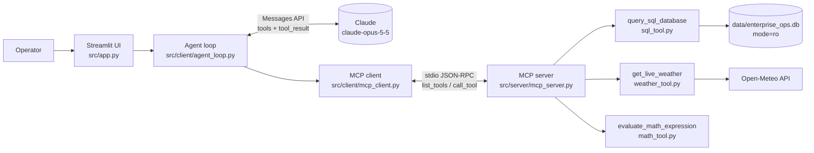

# mcp-agent-tools

A tool-augmented AI operations assistant built on the **Model Context Protocol (MCP)**. An MCP server exposes three sandboxed tools (read-only SQL, live weather, safe math). A host client discovers them over **stdio**, and Claude (Anthropic API) runs a multi-turn tool-calling loop. A Streamlit UI shows every step.

> Example: *"Check if our inventory in Seattle has enough stock of SKU-90210 to fulfill order #4492, verify if rainfall there will delay ground dispatch today, and calculate the total shipping insurance cost at 3.5% of the order value."*
> The agent queries SQLite, checks live Seattle weather, computes 3.5% of $10,740 = $375.90, and gives a grounded summary.

## Architecture



- **Server / client separation:** `mcp_server.py` only registers tools. The client starts it as a **child process** and talks to it over stdin/stdout (`stdio` transport).
- **Dynamic discovery:** the client calls `session.list_tools()` and maps each MCP `input_schema` to an Anthropic tool `{name, description, input_schema}`. Nothing is hardcoded.
- **Agent loop:** sends the prompt and tools to Claude, dispatches each `tool_use` via MCP, and returns `tool_result` blocks (matching `tool_use_id`, `is_error` on failure). It stops on a final answer or after `max_turns=5`.

## Project layout

```
data/            enterprise_ops.db (SQLite) + seed_db.py
src/server/      mcp_server.py, tools/{sql_tool, weather_tool, math_tool}.py
src/client/      mcp_client.py (stdio + discovery), agent_loop.py (tool loop)
src/app.py       Streamlit UI
tests/           test_server_tools.py, test_mcp_client.py, test_security.py
```

## Tools

| Tool | What it does | Guardrails |
|---|---|---|
| `query_sql_database(sql_query)` | Read-only query on customers, products, inventory, orders | Single statement, must start with `SELECT`, no comments or `;` stacking, keyword blocklist; SQLite `mode=ro` URI; authorizer allows only SELECT/READ/FUNCTION; 5 s timeout; 100-row cap |
| `get_live_weather(city)` | Current conditions + today's precipitation (Open-Meteo, no key) | City input normalized and validated; async `httpx` with timeouts; 429 retry then error; output reduced to whitelisted numeric fields and cleaned names |
| `evaluate_math_expression(expression)` | Exact arithmetic (`+ - * / // % **`, `sqrt`, `log`, `round`, ...) | `ast.parse` + whitelist visitor; **no `eval`/`exec`/`numexpr`**; size cap on powers; 2 s timeout |

All tools return JSON. Failures come back as `{"error": {"type", "message"}}` and never crash the server. Tool output is treated as untrusted data.

## Setup

Requires Python 3.11 and [uv](https://docs.astral.sh/uv/).

```
uv sync
cp .env.example .env
```

Put your key in `.env` (never commit it; `.gitignore` and `.dockerignore` exclude it):

```
ANTHROPIC_API_KEY=your_anthropic_key_here
```

Optional: rebuild the database with `uv run python data/seed_db.py`.

## Run

| What | Command |
|---|---|
| Tests (41) | `uv run pytest -v` |
| UI | `uv run streamlit run src/app.py` |
| MCP server alone (stdio) | `uv run python -m src.server.mcp_server` |
| Docker | `docker compose up --build`, then open http://localhost:8501 |
| Tests in Docker | `docker compose run --rm app pytest -v` |

The tests need no API key: Test 2 mocks Open-Meteo and Test 5 uses a scripted fake LLM against the real MCP server.

## UI

- **MCP Inspector** (sidebar): tools discovered at runtime, with their schemas.
- **Operator Console:** chat, plus a one-click example prompt; a live tool-call timeline showing the LLM's arguments, the raw MCP payload, iteration and latency.
- **Security Workbench:** the adversarial SQL probe (`SELECT * FROM orders; DROP TABLE inventory;--`) and the math probe (`__import__('os').listdir('.')`). Each runs directly against the tool or through the agent, followed by a health check showing the server and data are intact.

## Tests

| # | File | Checks |
|---|---|---|
| 1 | `test_server_tools.py` | SQL returns the expected columns and values (order #4492, Seattle stock) |
| 2 | `test_server_tools.py` | Mocked Open-Meteo response is formatted correctly |
| 3 | `test_server_tools.py` | `2 + 3 * (4 - 1) ** 2 == 29`, `10740 * 0.035 == 375.9` |
| 4 | `test_mcp_client.py` | stdio connect, discovery of all 3 tools, valid schemas, Anthropic mapping |
| 5 | `test_mcp_client.py` | SQL then Math chain ends with an assistant message in at most 3 turns |
| 6 | `test_security.py` | DROP/UPDATE/INSERT/DELETE/stacked/comment/ATTACH/PRAGMA rejected; writes blocked even with the validator bypassed; data intact |
| 7 | `test_security.py` | `__import__`, attribute/dunder chains, `eval`/`exec`/`open`, lambdas and comprehensions rejected by the AST whitelist |

## AI audit summary

The code was generated with Claude Code and audited phase by phase. The full log is in [`ai_prompt_log.md`](ai_prompt_log.md). Highlights:

1. **Stale SDK API:** the plan's `from mcp.server.fastmcp import FastMCP` fails on `mcp` 2.x (renamed `MCPServer`). Fixed after checking the installed SDK source.
2. **Math evaluator crashes:** huge integers exceeded Python's 4,300-digit string limit, and `(-8) ** 0.5` returned a non-serializable `complex`. Fixed with a pre-computation size cap and complex-result rejection.
3. **Over-strict validation:** the city regex rejected "St. Louis". Fixed.
4. The required risks (naive SQL filtering, `eval` ACE, schema mismatch, unbounded loops) are covered by layered defenses and verified by Tests 4–7.

## Tech

Python 3.11 · uv · `mcp` 2.x (`MCPServer`, formerly FastMCP) · Anthropic Python SDK (`claude-opus-5-5`) · httpx · SQLite · Streamlit · pytest / pytest-asyncio · Docker
